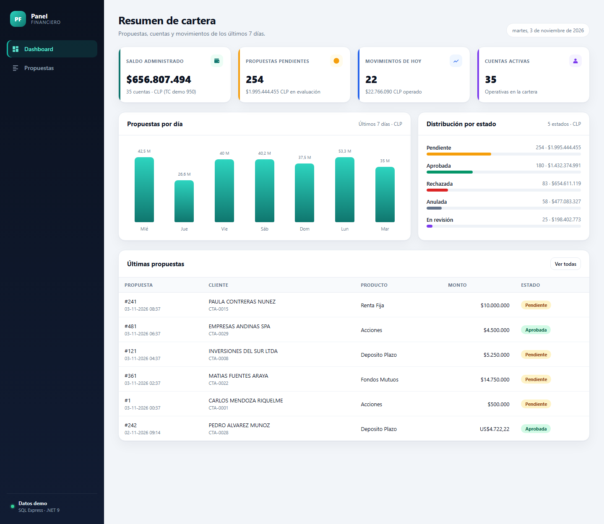
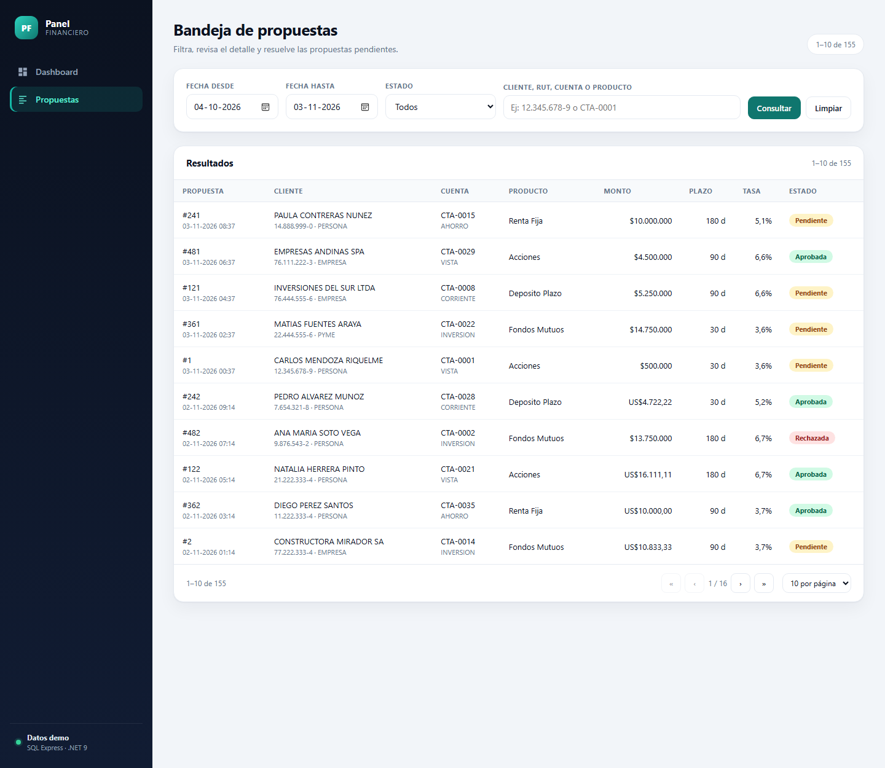
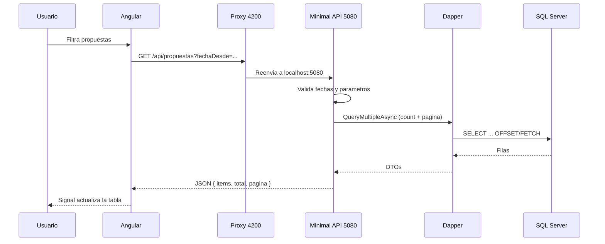
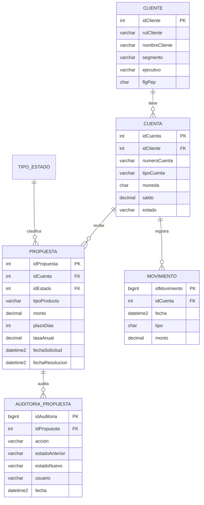

# Panel Financiero

Monitor de propuestas de inversión full stack, con datos 100% ficticios. Sirve como proyecto de práctica y portafolio para trabajar con SQL Server, .NET y Angular en un contexto financiero.



## Qué incluye

- **Dashboard** con saldos, propuestas pendientes, movimientos del dia, serie de 7 dias y distribucion por estado.
- **Bandeja de propuestas** con filtros por fecha, estado y texto, paginación en el servidor y detalle lateral.
- **Operaciones de cuentas**: movimientos (créditos/débitos) con filtros, resumen en CLP y paginación en el servidor.
- **Aprobar / rechazar** propuestas con transacción SQL, bloqueo `UPDLOCK`, validación de estado y auditoría.
- **Swagger** para probar la API sin Postman.
- **Datos de prueba deterministas**: 24 clientes, 40 cuentas, 600 propuestas y 2.000 movimientos, siempre relativos a la fecha de hoy.
- **Consultas SQL de ejemplo** con joins, CTE, funciónes de ventana y deteccion de duplicados.
- **SQL Server en Docker** (opcional) para quien clona el repo y no tiene SQL Server instalado.

| Bandeja de propuestas |
| --- |
|  |

## Stack

| Capa | Tecnologia |
| --- | --- |
| Frontend | Angular 21, standalone components, signals, SCSS/CSS propio, sin librerias de UI |
| Backend | ASP.NET Core 9, Minimal APIs, Dapper 2.1 |
| Base de datos | SQL Server Express (`.\SQLEXPRESS`), autenticación Windows |
| Documentación API | Swagger / OpenAPI (Swashbuckle) |
| Pruebas | Vitest (frontend), pruebas manuales con Swagger y `.http` |

No usa Entity Framework a propósito: el objetivo es prácticar SQL y ver exactamente que consulta se ejecuta.

## Estructura

```text
panel-financiero/
  api/
    Panel.Api/
      Comun/                 Parseo de fechas
      Data/                  Fábrica de conexiónes ADO.NET
      Features/
        Dashboard/           KPIs y serie de 7 dias
        Propuestas/          Bandeja, estados y aprobar/rechazar
        Operaciones/         Movimientos de cuentas (creditos/debitos)
      Program.cs             Arranque, Swagger, CORS, health
      Panel.Api.http         Peticiones de ejemplo
  sql/
    001_esquema.sql          Tablas, índices y vistas vwPropuestaDetalle y vwOperacionDetalle
    002_datos_prueba.sql     Datos ficticios (idempotente)
    003_consultas_ejemplo.sql Consultas y ejercicios de SQL
  web/
    src/app/core/            Modelos, servicios HTTP, interceptor de errores
    src/app/layout/          Sidebar y layout general
    src/app/features/        Dashboard, bandeja de propuestas y operaciones
    src/app/shared/          Pipes y badge de estado
  docker-compose.yml         SQL Server + carga de datos (opcional)
  .github/workflows/ci.yml   Build y pruebas en cada push
  docs/
    APRENDER.md              Guia para alguien que viene de VB6/VB.NET
    img/                     Capturas
  scripts/
    crear-bd.ps1             Crea la base y carga datos
    levantar.ps1             Levanta API + Angular en dos ventanas
```

## Requisitos

- .NET SDK **9**
- Node.js **20.19+, 22.12+ o 24** y npm
- SQL Server Express con instancia `.\SQLEXPRESS` (el proyecto se probo con SQL Server 2025 Express)
- Opcional: `sqlcmd` o SSMS para revisar la base

Verifica las versiones:

```powershell
dotnet --version
node --version
npm --version
sqlcmd -S .\SQLEXPRESS -E -Q "SELECT @@VERSION"
```

## Puesta en marcha

### 1. Crear la base de datos

```powershell
.\scripts\crear-bd.ps1
```

Si PowerShell bloquea scripts:

```powershell
powershell -ExecutionPolicy Bypass -File .\scripts\crear-bd.ps1
```

Equivale a ejecutar:

```powershell
sqlcmd -S .\SQLEXPRESS -E -b -f 65001 -i sql\001_esquema.sql
sqlcmd -S .\SQLEXPRESS -E -b -f 65001 -i sql\002_datos_prueba.sql
```

El script `002` se puede ejecutar varias veces: borra los datos anteriores y los vuelve a generar con IDs explicitos. Las fechas son relativas a `GETDATE()`, por lo que la bandeja siempre tiene actividad reciente.

> La base se llama `PanelFinanciero` y es independiente de AdventureWorks. No se toca ninguna base existente.

### Alternativa: la base con Docker (opcional)

Si el equipo donde vas a probar el proyecto no tiene SQL Server, `docker-compose.yml` levanta **SQL Server 2022 en un contenedor** y crea la base con esquema y datos en un solo paso:

```powershell
docker compose up -d
```

- El contenedor `panel-sqlserver` queda escuchando en `localhost,1433`.
- El contenedor `panel-initdb` ejecuta `sql/001_esquema.sql` y `sql/002_datos_prueba.sql` y termina.
- Para regenerar los datos: `docker compose up -d --force-recreate init-db`.
- Los datos viven en el volumen `sql-data`; para borrar todo: `docker compose down -v`.

La API necesita apuntar al contenedor. Arráncala con la variable de entorno (sin editar `appsettings.json`):

```powershell
cd api\Panel.Api
$env:ConnectionStrings__Panel = "Server=localhost,1433;Database=PanelFinanciero;User Id=sa;Password=Panel*2026!;TrustServerCertificate=True;Encrypt=False"
dotnet run
```

La contraseña se puede cambiar con la variable `SA_PASSWORD` antes de `docker compose up -d`. Es una base de práctica con datos ficticios: la contraseña simple es intencional y el contenedor no debe exponerse a internet.

### 2. Levantar la API

```powershell
cd api\Panel.Api
dotnet run
```

- API: <http://localhost:5080>
- Swagger: <http://localhost:5080/swagger>
- Health: <http://localhost:5080/api/health>

La cadena de conexión esta en `api/Panel.Api/appsettings.json`:

```json
"Panel": "Server=.\\SQLEXPRESS;Database=PanelFinanciero;Trusted_Connection=True;TrustServerCertificate=True;Encrypt=False"
```

### 3. Levantar Angular

En otra terminal:

```powershell
cd web
npm install
npm start
```

Abre <http://localhost:4200>. El archivo `web/proxy.conf.json` redirige `/api` a `http://localhost:5080`, por lo que el navegador nunca llama directo a la API en desarrollo.

### 4. Todo junto

```powershell
.\scripts\levantar.ps1
```

Abre dos ventanas de PowerShell (API y web), espera el health check y abre el navegador.

Para detener ambos servicios:

```powershell
.\scripts\detener.ps1
```

## Como funcióna una petición



Puntos clave:

- **Filtros y paginación se resuelven en SQL**, no en el navegador.
- **Dapper mapea por nombre de columna** a las propiedades del DTO. Si cambias un alias en SQL, cambia el DTO o el JSON queda vacio.
- **La vista `vwPropuestaDetalle`** concentra el join propuesta + cuenta + cliente + estado.
- **El interceptor** convierte cualquier error HTTP en un `ApiError` con un mensaje legible; la UI no manipula `HttpErrorResponse` directamente.

## Endpoints

| Método | Ruta | Descripción |
| --- | --- | --- |
| GET | `/api/health` | Estado de la API |
| GET | `/api/dashboard` | KPIs, serie de 7 dias, distribucion y ultimas propuestas |
| GET | `/api/propuestas` | Bandeja paginada (`fechaDesde`, `fechaHasta`, `estado`, `texto`, `pagina`, `tamano`) |
| GET | `/api/propuestas/estados` | Estados para el filtro |
| POST | `/api/propuestas/{id}/resolver` | Aprueba o rechaza una propuesta pendiente |
| GET | `/api/operaciones` | Movimientos paginados (`fechaDesde`, `fechaHasta`, `tipo` C/D, `texto`, `pagina`, `tamano`); incluye `resumen` con totales del filtro |

Ejemplo de aprobación:

```http
POST /api/propuestas/1/resolver
Content-Type: application/json

{
  "accion": "APROBAR",
  "usuario": "analista.demo",
  "comentario": "Cumple el perfil de riesgo"
}
```

Respuesta `200`:

```json
{
  "idPropuesta": 1,
  "codigoEstado": "APRO",
  "estado": "Aprobada",
  "usuario": "analista.demo",
  "comentario": "Cumple el perfil de riesgo"
}
```

Si se intenta resolver dos veces, la segunda responde `409` con un mensaje explicando el estado actual. Eso se prueba abriendo dos pestañas o ejecutando dos veces la petición.

### Fechas

La API acepta `yyyy-MM-dd` (lo que envia un `<input type="date">`) y `dd-MM-yyyy` (comodo para Swagger). El frontend envia siempre `yyyy-MM-dd`.

La bandeja inicia con los ultimos **30 dias**; el dashboard muestra los ultimos **7**.

## Modelo de datos



Decisiones de modelo:

- El saldo de la cuenta es un **snapshot**, no se recalcula desde los movimientos. En un sistema real se derivaria del libro mayor o se mantendria con procesos de consolidacion.
- Los montos se guardan en la moneda de la cuenta. Para los totales del dashboard se usa `montoClp` con un **tipo de cambio fijo de demo (1 USD = 950 CLP)**. En producción seria una tabla de tipos de cambio por fecha.
- La auditoría se escribe en la misma transacción que el cambio de estado. Si falla el insert, no se aprueba nada.

## Pruebas y verificacion

```powershell
# API
cd api\Panel.Api
dotnet build

# Frontend
cd web
npm run build
npm test -- --watch=false
```

Prueba manual rapida:

1. Abre Swagger y ejecuta `GET /api/dashboard`.
2. Ejecuta `GET /api/propuestas?fechaDesde=2026-10-01&fechaHasta=2026-11-03&pagina=1&tamano=10`.
3. Aprueba una propuesta pendiente y revisa la tabla de auditoría:

```sql
USE PanelFinanciero;
SELECT TOP (5) *
FROM dbo.AuditoriaPropuesta
ORDER BY idAuditoria DESC;
```

## Problemas comunes

| Sintoma | Causa probable | Solucion |
| --- | --- | --- |
| `Cannot open database "PanelFinanciero"` | No se ejecuto el esquema | `.\scripts\crear-bd.ps1` |
| `Login failed for user` | Instancia o autenticación incorrecta | Usa `.\SQLEXPRESS` y autenticación Windows |
| `No se pudo conectar con la API` en la web | La API no esta corriendo en 5080 | `cd api\Panel.Api; dotnet run` |
| La web muestra datos viejos | El seed no se ha vuelto a ejecutar | `sqlcmd ... -i sql\002_datos_prueba.sql` |
| El puerto 4200 u 5080 esta ocupado | Otro proceso lo usa | Cambia el puerto en `launchSettings.json` y `proxy.conf.json` |
| Swagger no aparece | `ASPNETCORE_ENVIRONMENT` no es Development | Ejecuta con el perfil `http` o define la variable |
| `sqlcmd` no se reconoce | Herramientas no instaladas | Ejecuta los scripts desde SSMS/Azure Data Studio |

## Que aprender con este proyecto

La guia [`docs/APRENDER.md`](docs/APRENDER.md) traduce los conceptos de VB6/VB.NET a la web y propone ejercicios concretos para romper y arreglar la aplicacion: cambiar un filtro SQL, simular un error 500, provocar un conflicto de aprobación, revisar un plan de ejecucion y agregar un endpoint nuevo.

Las consultas de [`sql/003_consultas_ejemplo.sql`](sql/003_consultas_ejemplo.sql) estan pensadas para prácticar SQL de analista: CTE, `ROW_NUMBER`, `LAG`, `PERCENTILE_CONT`, agregaciones condicionales y deteccion de duplicados.

## Próximos pasos sugeridos

1. **Login y roles**: JWT, usuario real en auditoría, roles analista/supervisor.
2. **Operaciones**: exportación CSV, detalle por cuenta y filtro por segmento.
3. **Máquina de estados**: impedir transiciones inválidas mas alla de pendiente -> aprobada/rechazada.
4. **Pruebas de API**: xUnit + base de datos de prueba; pruebas de concurrencia del endpoint resolver.
5. **Docker Compose**: SQL Server en Linux + API + Angular servido por nginx.
6. **CI**: GitHub Actions con `dotnet build`, `npm test` y `npm run build`.
7. **Tipos de cambio**: reemplazar el 950 fijo por una tabla historica.
8. **Observabilidad**: logs estructurados, correlation id y métricas.

## Datos y alcance

Todos los clientes, RUT, cuentas y montos son ficticios. El proyecto no contiene codigo, esquemas ni datos de ninguna empresa. La base AdventureWorks instalada en el equipo no se modifica ni se usa en tiempo de ejecucion.

Este repositorio es material de aprendizaje; no esta pensado para producción tal como está.
