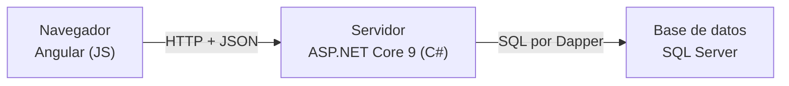
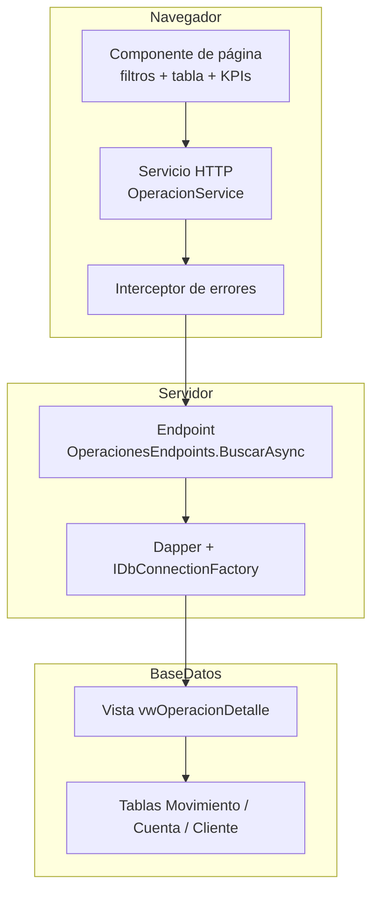

# Arquitectura y depuración de Panel Financiero

Documento para entender **cómo está armada la app y cómo recorrerla con el depurador**. Está escrito para quien viene de aplicaciones de escritorio (VB6 / VB.NET con formularios, módulos de datos y SQL Server) y también sirve como guía de entrada para quien revisa este repositorio.

## 1. El mapa general: tres programas, no uno

En VB.NET tenías un solo `.exe` con formularios, un módulo de acceso a datos y una conexión a SQL Server. Aquí eso se separó en **tres programas** que se hablan entre sí:



| Proceso | Qué es | Cómo se ejecuta | Puerto |
| --- | --- | --- | --- |
| **Web (Angular)** | El "formulario". Corre **dentro del navegador** | `npm start` (solo desarrollo) | 4200 |
| **API (.NET)** | La "lógica de negocio + acceso a datos". Corre en el servidor | `dotnet run` | 5080 |
| **Base de datos** | Tablas, vistas, índices, transacciones | Servicio de Windows (o contenedor Docker) | instancia `.\SQLEXPRESS` |

Consecuencias prácticas (lo que más cuesta si vienes del escritorio):

- No hay variables compartidas entre "formularios": cada pantalla guarda su propio estado (signals) y lo que comparte vive en servicios.
- La comunicación es **asíncrona**: una consulta no bloquea la pantalla; la tabla se rellena cuando llega la respuesta.
- El "exe" que corre en el navegador y el que corre en el servidor son **procesos distintos**: se depuran con herramientas distintas (Chrome DevTools vs. depurador de VS Code).

## 2. Arquitectura por capas (y qué archivo vive en cada una)



**Regla del proyecto:** cada capa solo conoce a la vecina inmediata. El componente no arma SQL; el endpoint no sabe de tablas HTML; SQL Server no sabe de pantallas.

### Mapa de archivos por feature (caso "Operaciones")

| Capa | Archivo | Rol (equivalente VB.NET) |
| --- | --- | --- |
| SQL | `sql/001_esquema.sql` → `vwOperacionDetalle` | Vista con los joins ya hechos |
| Contrato C# | `Features/Operaciones/OperacionDto.cs` | Recordset tipado / DTO |
| Endpoint | `Features/Operaciones/OperacionesEndpoints.cs` | Stored procedure con validaciones |
| Registro | `Program.cs` (`app.MapOperacionesEndpoints()`) | Punto de arranque |
| Modelo TS | `core/models/operacion.model.ts` | Clase que refleja el DTO |
| Servicio | `core/services/operacion.service.ts` | Módulo de datos del formulario |
| Pantalla | `features/operaciones/operaciones-page.ts/.html/.css` | `frmOperaciones` |
| Ruta + menú | `app.routes.ts`, `layout/shell/shell.html` | Menú principal |
| Infraestructura | `Data/DbConnectionFactory.cs`, `Comun/Fechas.cs`, `core/http/error.interceptor.ts` | Cadena de conexión, utilidades, manejo de errores global |

Las otras dos features (`Dashboard`, `Propuestas`) siguen exactamente la misma estructura.

## 3. El viaje de una petición (de punta a punta)

Tomemos "Consultar" en la pestaña Operaciones:

1. `(click)="aplicar()"` en `operaciones-page.html` → `aplicar()` en el `.ts`.
2. El componente llama a `OperacionService.buscar(filtros)`.
3. `HttpClient` hace `GET /api/operaciones?fechaDesde=...&pagina=1` al puerto **4200**.
4. El proxy de desarrollo (`web/proxy.conf.json`) reenvía todo `/api` a **5080**. En producción sería el mismo dominio.
5. `BuscarAsync` valida fechas, tipo y paginación; si algo está mal responde **400** con un mensaje en español.
6. Dapper ejecuta **un viaje con dos consultas** (`QueryMultiple`): el resumen (SUM por tipo) y la página (OFFSET/FETCH).
7. SQL Server responde filas de `vwOperacionDetalle`; Dapper las mapea **por nombre de columna** a los DTO.
8. La API devuelve JSON: `{ items, total, pagina, totalPaginas, resumen }`.
9. El componente guarda la respuesta en `datos` (un signal) y Angular re-dibuja tabla, KPIs y paginación.

**Si algo no aparece en pantalla, el problema está en uno de estos 9 pasos.** La pestaña *Network* de DevTools te dice si la respuesta llegó bien (paso 8) o no.

## 4. Cómo depurar cada capa

### 4.1 API .NET (breakpoints reales, como en Visual Studio)

1. Abre la carpeta raíz en VS Code (extensión **C# Dev Kit**).
2. `F5` y elige la configuración **API Panel (.NET)** (`launch.json` ya está preparado).
3. Breakpoints recomendados:
   - Primera línea de `BuscarAsync` → inspecciona `fechaDesde`, `tipo`, `pagina`.
   - Justo antes de `QueryMultipleAsync` → pásale el mouse a `sql` y `parametros`: ves **la consulta exacta** que irá a SQL (equivalente a depurar tu Command de ADO.NET).
   - Dentro de `ResolverAsync` (Propuestas) → sigue la transacción paso a paso.
4. Desde la web, presiona "Consultar": el breakpoint se detiene.

Sin depurador: `dotnet run` + Swagger (`http://localhost:5080/swagger`) permite ejecutar cualquier endpoint con parámetros a mano, como probar un stored procedure desde SSMS.

### 4.2 Frontend Angular (Chrome DevTools, F12)

- **Console**: errores de TypeScript y del interceptor.
- **Network**: filtra `api`; mira URL, *status* y la respuesta JSON cruda. Si el JSON está bien y la tabla no muestra nada, el error es de nombres de propiedades en la plantilla.
- **Sources**: busca `operaciones-page.ts` y pon breakpoint en `cargar()` o `aplicar()`. También puedes escribir `debugger;` en el código.
- El estado vive en signals: para inspeccionarlo rápido agrega temporalmente `console.log('datos', this.datos());`.

### 4.3 SQL Server (SSMS / Azure Data Studio)

```sql
USE PanelFinanciero;
SELECT TOP (20) * FROM dbo.vwOperacionDetalle ORDER BY fecha DESC;

-- Lo mismo que ejecuta el endpoint, con parámetros:
EXEC sp_executesql N'
    SELECT COUNT(*) FROM dbo.vwOperacionDetalle
    WHERE fecha >= @desde AND fecha < @hastaExclusivo',
    N'@desde DATETIME2, @hastaExclusivo DATETIME2',
    @desde = '2026-10-13', @hastaExclusivo = '2026-11-13';
```

- Para capturar el SQL real que envía Dapper: copia `sql` + `parametros` desde el breakpoint de la API (4.1).
- `SET STATISTICS IO ON;` antes de una consulta muestra lecturas lógicas: sirve para evaluar índices.

### 4.4 Recetas de diagnóstico rápido

| Síntoma | Primera sospecha | Dónde mirar |
| --- | --- | --- |
| Tabla vacía y Network muestra JSON con `items: []` | El filtro no encontró filas | Ejecuta la consulta en SSMS (4.3) |
| Toast "no se pudo conectar" | La API está caída | `dotnet run` en `api\Panel.Api` |
| `500` en Network | Excepción en el endpoint | Consola de la API (stack trace) |
| Columna vacía en la tabla | Alias SQL ≠ nombre en DTO/modelo | `OperacionDto` vs vista |
| 409 al aprobar propuesta | Ya estaba resuelta (correcto) | Tabla `AuditoriaPropuesta` |

La guía completa de ejercicios para romper y arreglar está en [`APRENDER.md`](APRENDER.md).

## 5. Equivalencias rápidas VB.NET → esta app

| VB.NET | Aquí |
| --- | --- |
| `Form_Load` | `ngOnInit()` |
| `TextBox` / `ComboBox` / `DataGridView` | `<input>` / `<select>` / `<table>` |
| `Button_Click` | `(click)="metodo()"` |
| `Recordset` | Interfaz TS + signal (`datos()`) |
| `ADODB.Connection` | `DbConnectionFactory` + Dapper |
| Stored procedure | Endpoint + SQL parametrizado |
| `MsgBox` | Toast (`NotificacionService`) |
| `On Error GoTo` | try/catch + `ProblemDetails` + interceptor |
| `Refresh` del form | `signal.set(...)` re-dibuja |

## 6. Correr el proyecto tú mismo

**Camino principal (Windows + SQL Server Express), 3 comandos:**

```powershell
git clone https://github.com/CarlosAndres1983/panel-financiero.git
cd panel-financiero
.\scripts\crear-bd.ps1      # crea la base PanelFinanciero y carga datos de prueba
.\scripts\levantar.ps1      # abre API (5080) y web (4200) y abre el navegador
```

Requisitos: .NET 9 SDK, Node.js 20.19+/22+, SQL Server Express con instancia `.\SQLEXPRESS`. Detalles en el [README](../README.md).

**Camino alternativo (sin SQL Server instalado), con Docker:**

```bash
docker compose up -d        # SQL Server 2022 + esquema + datos, todo automático
```

y la API arranca apuntando al contenedor con `ConnectionStrings__Panel` (ver README). Este camino es para quien no usa Windows; la depuración con breakpoints se hace en el camino principal.

## 7. Orden de lectura recomendado (5 archivos, 20 minutos)

1. Este documento (arquitectura y flujo).
2. `Program.cs` — 60 líneas: ves cómo se arma todo.
3. `OperacionesEndpoints.cs` — un endpoint completo con validación, `QueryMultiple` y SQL.
4. `operaciones-page.ts` — el mismo caso desde el navegador.
5. `001_esquema.sql` — tablas, índices y las dos vistas.
